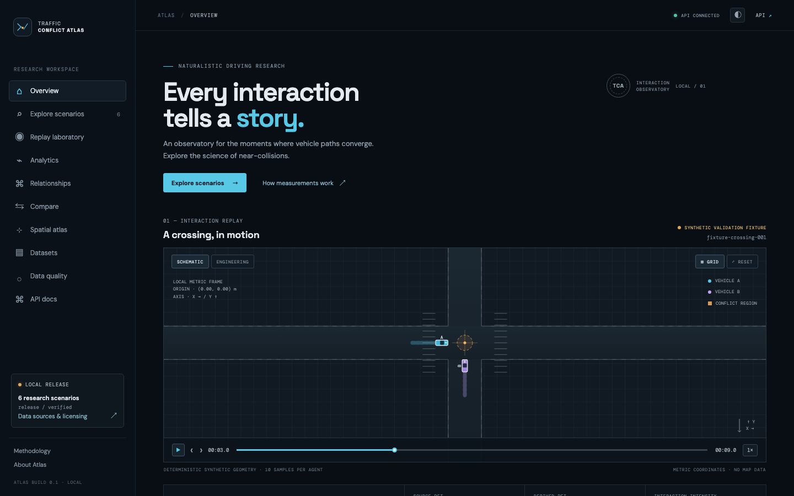
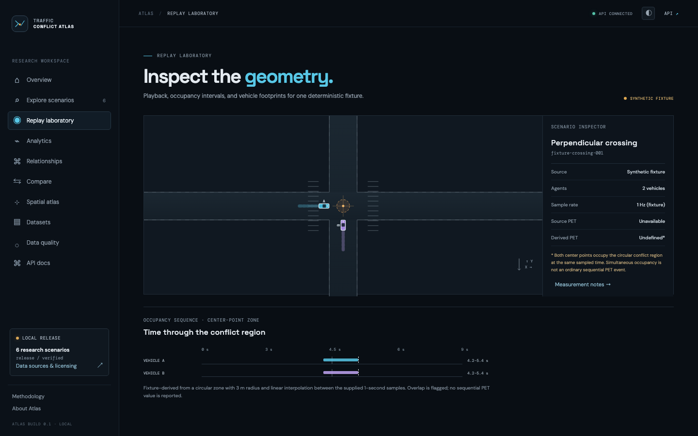
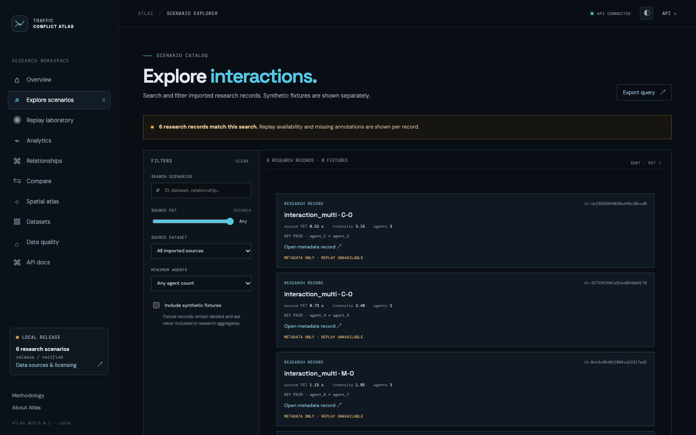
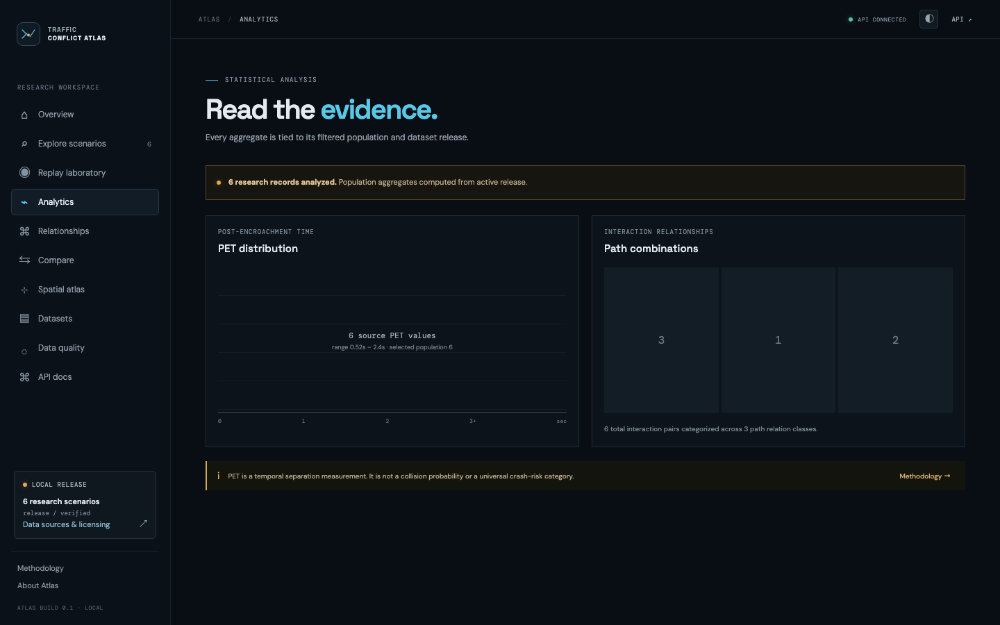
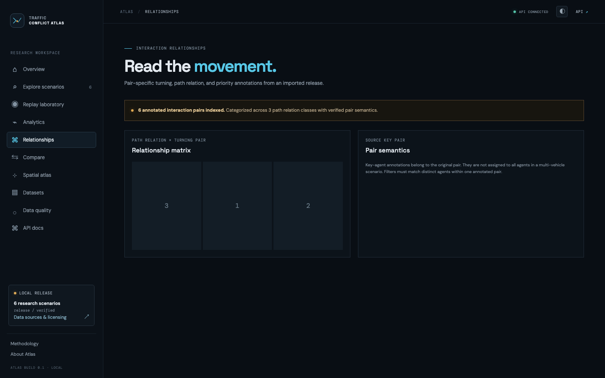
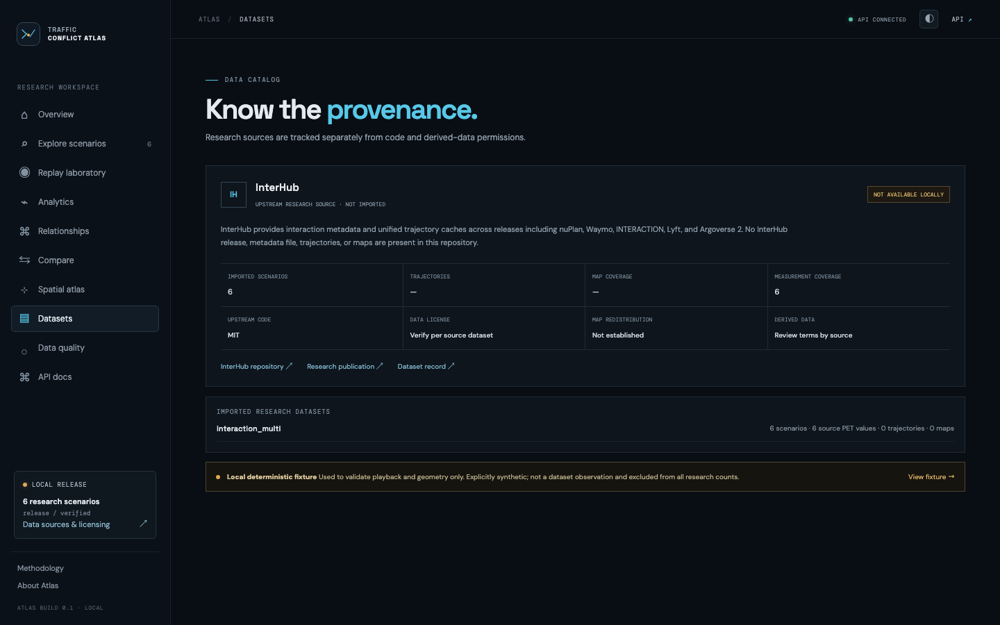
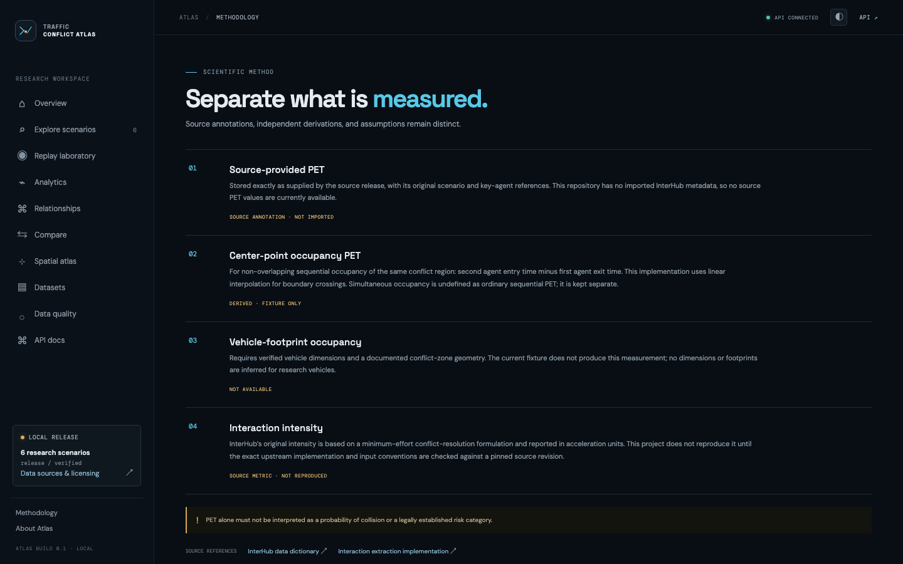
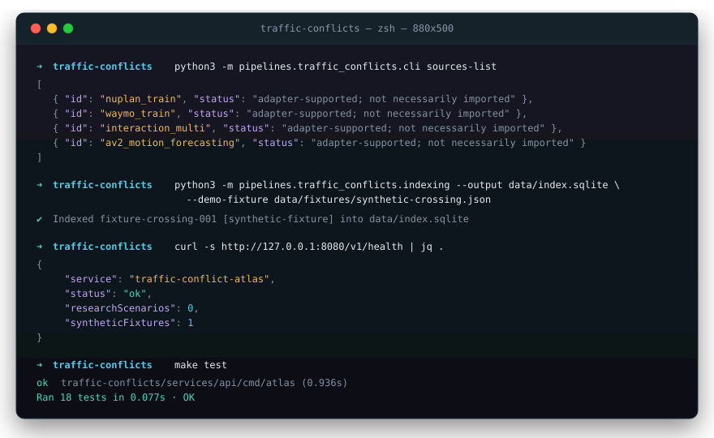

# Traffic Conflict Atlas

**Explore the science of near-collisions.**

Traffic Conflict Atlas is an open-source observatory for inspecting, replaying, and analyzing naturalistic vehicle interaction events and surrogate traffic safety measures. It is engineered with strict scientific integrity: observed annotations, independent calculations, and missing data are kept rigorously distinct.

[](mailto:work@withrana.com) [](https://www.linkedin.com/in/workwithrana)
[](https://www.upwork.com/freelancers/~01bbcf6edb91a8df5f)
[](https://contra.com/ranajahanzaib/)



---

## The Problem It Solves

Surrogate safety measures—such as Post-Encroachment Time (PET) and interaction intensity—are crucial for understanding traffic safety before crashes happen. However, working with naturalistic driving datasets (nuPlan, Waymo, INTERACTION, Lyft, Argoverse 2) poses major research challenges:

1. **Conflation of Observations and Models:** Datasets often mix raw trajectory observations with opaque model-derived metrics without clear provenance.
2. **Silent Failure and Fabricated Data:** Tools often interpolate across missing sensor frames or replace undefined values with zeros, creating artificial collision risks.
3. **Complex Licensing & Attribution:** Upstream datasets have distinct, restrictive licensing terms. Code licenses (e.g. MIT) do not confer redistribution rights for the underlying trajectory data or HD maps.

**Traffic Conflict Atlas solves these problems** by providing a clean, auditable platform that enforces strict provenance, treats synthetic fixtures separately from research data, isolates licensed source data from code distribution, and implements verified geometric PET algorithms with boundary interpolation.

---

## Key Features

- **Interactive Replay Laboratory:** Step-by-step vector simulation of vehicle trajectories through circular conflict regions with timeline scrubbing, speed control, coordinate telemetry, and occupancy interval tracking.
- **Scenario Explorer:** Filter and search scenarios across datasets, path relations (crossing, merging, following), minimum agent counts, and source PET thresholds.
- **Scientific Metric Calculation:** Deterministic post-encroachment time (PET) computation for circular conflict zones with linear boundary interpolation. Simultaneous or overlapping occupancies are explicitly flagged as undefined rather than falsified.
- **Data Quality & Provenance Tracking:** Quality flag auditing that isolates non-monotonic timestamps, missing sensor dimensions, priority status mismatches, and schema violations.
- **Unified Read-Only API:** High-performance Go service powered by pure-Go SQLite (`modernc.org/sqlite`) serving normalized scenarios, agent dimensions, trajectories, and OpenAPI 3.1 specifications.
- **Reproducible Python CLI Pipeline:** Standard-library CLI for inspecting metadata schemas, validating row annotations, generating offline search indexes, and compiling distribution aggregates.

---

## Visual Tour

### Replay Laboratory

Detailed inspection of vehicle trajectories, conflict zone entry/exit times, and occupancy intervals for verified interaction events.



### Scenario Explorer & Filtering

Search across research scenarios with parameter filters for PET ranges, agent counts, and source dataset selection. Synthetic test fixtures require explicit opt-in and remain quarantined from research aggregations.



### Statistical Distributions & Analytics

Explore PET distribution histograms, interaction intensity distributions, and speed profiles across normalized datasets.



### Conflict Relationships

Taxonomy of interaction categories—perpendicular crossings, merges, diverging paths, and following maneuvers—preserving original annotations alongside normalized taxonomies.



### Data Provenance & Source Licensing

Auditable license status, attribution requirements, and redistribution terms for supported dataset adapters (nuPlan, Waymo, INTERACTION, Lyft, Argoverse 2).



### PET Methodology & Mathematical Rigor

Clear mathematical definitions, boundary conditions, and limitations for center-point occupancy versus vehicle-footprint surrogate safety measures.



---

## Architecture

Traffic Conflict Atlas is structured as a decoupled monorepo:

```text
traffic-conflicts/
├── apps/
│   └── web/                   # React 19 + TypeScript + Vite interactive dashboard
├── services/
│   └── api/                   # Read-only Go API server with modernc.org/sqlite
├── pipelines/
│   └── traffic_conflicts/     # Python metadata pipeline, indexing, and PET math
├── schemas/
│   └── index.sql              # Transactional SQLite schema with quarantine tables
├── data/
│   ├── fixtures/              # Deterministic synthetic test geometry
│   └── manifests/             # Source-specific license review manifests
└── docs/                      # Architecture, methodology, and screenshots
```

- **Frontend (`apps/web`):** Built with React 19, TypeScript, and Vite. Renders interactive SVG trajectory canvases, dual schematic/engineering viewports, and light/dark theme switching with zero external UI framework bloat.
- **Backend API (`services/api`):** Go standard library HTTP server with pure-Go SQLite. Operates strictly in read-only mode (`mode=ro`) to prevent concurrent write contention. Serves both the JSON API (`/v1/*`) and static frontend assets.
- **Data Pipeline (`pipelines/`):** Python standard library pipeline for metadata ingestion, quality validation, SQLite indexing, and geometric PET calculation.

---

## Quick Start

### Prerequisites

- **Go:** 1.27+
- **Python:** 3.10+
- **Node.js:** 22+
- **pnpm:** 12+

### 1. Install & Build Frontend

```sh
pnpm --dir apps/web install --frozen-lockfile
make frontend-build
```

### 2. Generate Synthetic Demo Index

Index the bundled deterministic synthetic crossing scenario:

```sh
make demo-data
```

### 3. Start the Server

```sh
make dev
```

Open [http://localhost:8080](http://localhost:8080) in your browser. The single Go binary serves both the interactive dashboard and the REST API.

To configure a custom bind address or database location:

```sh
ATLAS_ADDR=127.0.0.1:8090 make dev
```

For hot-reload frontend development, run the API on port 8080 with `make api`, then start Vite dev server in another terminal with `make frontend-dev` (opens [http://localhost:5173](http://localhost:5173) with automatic `/v1` proxying).

---

## REST API Reference

The service provides a read-only HTTP+JSON API with OpenAPI 3.1 documentation:

| Endpoint                    | Method | Description                                                                          |
| :-------------------------- | :----: | :----------------------------------------------------------------------------------- |
| `/v1/health`                | `GET`  | Service status, index reachability, and scenario counts                              |
| `/v1/overview`              | `GET`  | Summary statistics of indexed research data and fixtures                             |
| `/v1/scenarios`             | `GET`  | Paginated search of research scenarios (`?includeFixtures=true` to include fixtures) |
| `/v1/scenarios/{id}`        | `GET`  | Detailed scenario record, agent lists, and trajectory availability                   |
| `/v1/scenarios/{id}/agents` | `GET`  | Agent dimensions, vehicle types, and turning/priority annotations                    |
| `/v1/datasets`              | `GET`  | Catalog of imported datasets and their license review status                         |
| `/v1/openapi.json`          | `GET`  | Full OpenAPI 3.1 specification schema                                                |

### Example Queries

```sh
# Health check
curl -s http://localhost:8080/v1/health

# Overview stats
curl -s http://localhost:8080/v1/overview

# Query synthetic fixture scenario
curl -s 'http://localhost:8080/v1/scenarios/fixture-crossing-001?includeFixtures=true'

# OpenAPI specification
curl -s http://localhost:8080/v1/openapi.json
```

---

## Python CLI Pipeline

The command-line interface inspects, normalizes, validates, and indexes InterHub-style metadata CSV files into SQLite.



### CLI Commands

```sh
# List supported dataset adapters
python3 -m pipelines.traffic_conflicts.cli sources-list

# Inspect CSV columns and schema compatibility
python3 -m pipelines.traffic_conflicts.cli sources-inspect --input /path/to/metadata.csv

# Normalize and audit rows into JSONL
python3 -m pipelines.traffic_conflicts.cli normalize \
  --input /path/to/metadata.csv \
  --source-release v1.0 \
  --output data/processed.jsonl

# Ingest and build a research SQLite index (requires reviewed license manifest)
python3 -m pipelines.traffic_conflicts.cli build-index \
  --source interaction_multi \
  --source-release v1.0 \
  --license-manifest data/manifests/license.example.json \
  --input /path/to/metadata.csv \
  --output data/index.sqlite

# Compile release-level distribution aggregates
python3 -m pipelines.traffic_conflicts.cli build-aggregates \
  --input data/index.sqlite \
  --output data/aggregates.json
```

---

## Verification & Testing

Every commit and pull request runs automated validation suites across the Go service, Python pipeline, and TypeScript frontend:

```sh
# Run all unit tests (Go test + Python unittest)
make test

# Typecheck and lint frontend
make frontend-lint

# Build production artifacts (Vite bundle + compiled Go binary)
make build

# Validate supported source catalog
make validate
```

All 18 Python unit tests and Go API unit tests pass without external dependencies:

```text
Ran 18 tests in 0.077s · OK
PASS: traffic-conflicts/services/api/cmd/atlas (0.936s)
```

---

## Scientific Limits & PET Methodology

1. **Center-Point Simplification:** The bundled PET algorithm models vehicles as 2D center points moving through a circular conflict zone with linear boundary interpolation between discrete time samples. It does not compute full vehicle-footprint or polygon mesh collision.
2. **Undefined Overlapping Occupancies:** When two vehicle center points occupy the conflict region concurrently, the sequential post-encroachment time is mathematically undefined. Traffic Conflict Atlas flags simultaneous occupancy rather than reporting a misleading $PET = 0$.
3. **No Fabricated Data:** Trajectories, HD maps, and intensity measures are only reported when verified upstream records exist. When telemetry is missing or unindexed, the application explicitly reports it as unavailable.

For full mathematical derivations, see [PET Methodology](docs/pet-methodology.md).

---

## Sources and Attribution

- [InterHub Repository & Code](https://github.com/zxc-tju/InterHub)
- [InterHub Publication (Nature Scientific Data 2025)](https://doi.org/10.1038/s41597-025-05344-7)
- [InterHub Dataset Record (Figshare)](https://figshare.com/articles/dataset/_/27899754)
- Underlying Datasets: [nuPlan](https://www.nuplan.org/), [Waymo Open Dataset](https://waymo.com/open/), [INTERACTION Dataset](http://interaction-dataset.com/), [Lyft Level 5](https://level-5.global/), [Argoverse 2](https://www.argoverse.org/)

---

## License & Custom Work

[](mailto:work@withrana.com) [](https://www.linkedin.com/in/workwithrana)
[](https://www.upwork.com/freelancers/~01bbcf6edb91a8df5f)
[](https://contra.com/ranajahanzaib/)

**License:** MIT, see [LICENSE](LICENSE). Free for personal, academic, and commercial use. Upstream dataset terms and map permissions remain independent and must be reviewed per source.

**Author:** Rana Jahanzaib

**Need custom transportation analytics or high-reliability infrastructure built for your stack?**  
Email: [work@withrana.com](mailto:work@withrana.com)
